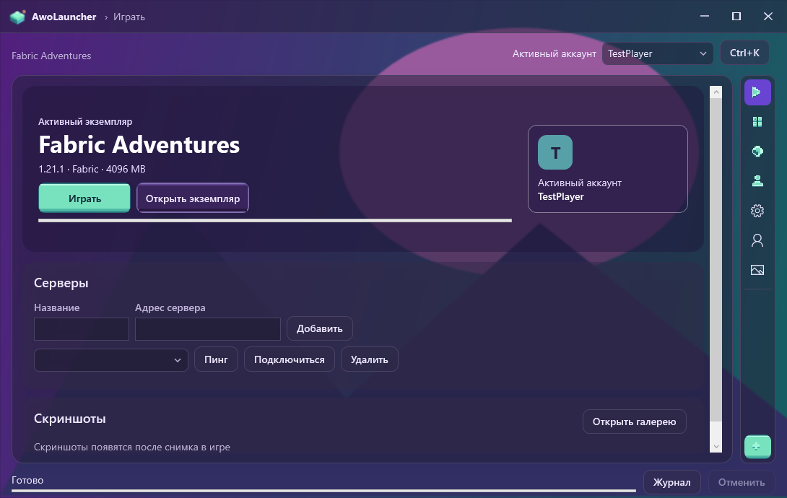

<p align="center">
  
</p>

<h1 align="center">AwoLauncher</h1>

<p align="center">Лаунчер Minecraft Java Edition для Windows с отдельными сборками, каталогом Modrinth и настройкой интерфейса.</p>

<p align="center">
  <a href="https://github.com/Amorsev/AwoLauncher/releases/latest"></a>
  
  
</p>

<p align="center">
  <a href="https://github.com/Amorsev/AwoLauncher/releases/latest/download/AwoLauncher-Setup.exe"><strong>Скачать установщик</strong></a>
  &nbsp;·&nbsp;
  <a href="https://github.com/Amorsev/AwoLauncher/releases/latest/download/AwoLauncher.exe">Переносимый EXE</a>
  &nbsp;·&nbsp;
  <a href="https://github.com/Amorsev/AwoLauncher/releases/latest">Страница релиза</a>
</p>



## Установка

| Вариант | Как запустить |
| --- | --- |
| **Установщик** | Скачайте [AwoLauncher-Setup.exe](https://github.com/Amorsev/AwoLauncher/releases/latest/download/AwoLauncher-Setup.exe) и запустите его. Программа установится для текущего пользователя и появится в меню «Пуск». |
| **Переносимый EXE** | Скачайте [AwoLauncher.exe](https://github.com/Amorsev/AwoLauncher/releases/latest/download/AwoLauncher.exe), положите в удобную папку и запустите. Для обновления переносимой копии замените EXE новым файлом. |
| **Из исходников** | Клонируйте репозиторий или скачайте `Source code (zip)` на странице релиза. Установите .NET 8 SDK для Windows и выполните [команды сборки](#сборка-из-исходников). |

Готовые EXE рассчитаны на Windows x64 и включают среду .NET. Файлы выпускаются без цифровой подписи. Сверить скачанные файлы можно по [SHA256SUMS.txt](https://github.com/Amorsev/AwoLauncher/releases/latest/download/SHA256SUMS.txt).

Устанавливали закрытую сборку 1.2.0? Переход на 1.0.0 выполните вручную через новый установщик или заменой переносимого EXE. Запущенная 1.2.0 считает номер 1.0.0 более старым.

## Первый запуск

1. Добавьте офлайн-профиль в разделе «Аккаунты».
2. Создайте экземпляр. Выберите версию Minecraft и, при необходимости, Fabric, Forge, Quilt или NeoForge.
3. Нажмите «Играть». При первой установке потребуется интернет для загрузки игры, библиотек и Java.

Данные по умолчанию хранятся в `%LOCALAPPDATA%\AwoLauncher`, в том числе при запуске переносимого EXE. У каждого экземпляра своя папка `.minecraft`. Удаление программы через установщик сохраняет игровые данные. Офлайн-профили подходят для одиночной игры и серверов, которые допускают офлайн-сессии.

## Возможности

- **Библиотека экземпляров.** Недавние запуски, быстрый выбор, дублирование и экспорт ZIP. `Ctrl+Tab` переключает экземпляр, `Ctrl+K` открывает поиск по лаунчеру.
- **Каталог Modrinth.** Фильтры по версии игры и загрузчику, подробные страницы проектов и галереи, установка подходящих версий и обязательных зависимостей. Поддерживаются моды, ресурспаки, шейдеры и сборки `.mrpack`.
- **Импорт и обновления сборок.** Перетащите `.mrpack` или `.jar` в окно. Для сборок, установленных через каталог с сохранённым источником, обновление показывает изменения файлов перед применением.
- **Локальные скины.** Импорт PNG 64×64 или 64×32 и гардероб. В Minecraft 1.20.2+ локальный ресурспак меняет текстуру в вашем клиенте. CustomSkinLoader подключается отдельно во вкладке «Синхронизация».
- **Оформление.** Светлая, тёмная и системная темы, RU/EN, пользовательский фон и прозрачность панелей. Фон для всего окна включает 50% прозрачности по умолчанию.
- **Инструменты запуска.** Общая Java для экземпляров, настройки RAM, журнал и подсказки при сбоях, локальная статистика, скриншоты и необязательный Discord Rich Presence.

## Обновления через GitHub

Лаунчер проверяет официальный канал при запуске и по кнопке «Проверить обновления» в настройках. Канал читает `update.json` из последнего стабильного релиза GitHub. Если номер версии выше установленного, можно подтвердить загрузку. Лаунчер проверит SHA-512 скачанного установщика, запустит его и закроется.

Адрес канала можно переопределить через `updateFeed` в `appsettings.json` рядом с EXE. Пустая строка отключает проверку. Сборка для публикации генерирует `update.json` автоматически. Загружайте этот файл вместе с установщиком в каждый стабильный релиз.

## Сборка из исходников

```powershell
git clone https://github.com/Amorsev/AwoLauncher.git
cd AwoLauncher
dotnet restore AwoLauncher.sln
dotnet build AwoLauncher.sln -c Release --no-restore
dotnet run --project Launcher.UI -c Release --no-build
```

Для автономного EXE и установщика нужен Inno Setup. Укажите фактический путь к компилятору `ISCC.exe`.

```powershell
./packaging/Build-Windows.ps1 -InnoCompiler "C:\Path\To\Inno Setup\ISCC.exe"
```

Папка `artifacts` будет содержать оба EXE, `SHA256SUMS.txt` и `update.json`.

## Как устроен проект

| Путь | Содержимое |
| --- | --- |
| [Launcher.Core](Launcher.Core) | Профили, игровые экземпляры, Modrinth, файлы сборок и запуск Minecraft |
| [Launcher.UI](Launcher.UI) | WPF, ViewModels, страницы, темы и локализация |
| [packaging](packaging) | Сборка автономного EXE, установщика и манифеста обновлений |

Чтобы добавить тему, скопируйте [Light.xaml](Launcher.UI/Themes/Light.xaml), сохраните имена кистей и зарегистрируйте словарь в `ThemeService` и списке тем в `ProductViewModel`. Подписи RU/EN лежат в [ресурсах](Launcher.UI/Resources).

Нашли ошибку? Укажите версию лаунчера, версию Minecraft, загрузчик и шаги воспроизведения. [Создать issue](https://github.com/Amorsev/AwoLauncher/issues/new)
